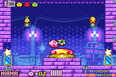

# Shared chest, lever, and Big Switch reward art

Every treasure chest uses the supplied six-gem reward art on opening. The
closed chest, rising popup motion, sounds, duration, original reward logic, and
check IDs are unchanged. A physical lever pull shows the same art because it
uses the same native popup path. Receiving Lever Wall, restoring a lever, or
re-entering its room does not show the art. The same gem also appears on the
first physical press of an Archipelago Big Switch. Other reward surfaces are
unchanged.

| Original | Same frame with this patch |
| --- | --- |
|  |  |

Both panels are native mGBA frames from a cold Tutorial World Map Chest replay
(room 805, frame 18405), with identical input and no gameplay-RAM edits. Exactly
206 rendered pixels differ, all inside the 16×16 sprite at (104, 57).
The compared runs recorded the same chest flags and reached Central Circle.

## Physical lever replay

| Chest-only control | Same frame with lever art |
| --- | --- |
|  |  |

These are native mGBA frames from Moonlight Mansion Room 2-11 (internal room
743), 12 frames after the physical lever pull at frame 40902. Both input-only
runs started from blank SRAM and matched all 115 replay checkpoints through
frame 41104, with no gameplay RAM edits or save-state loads. All changed pixels
in the comparison are inside the 16×16 sprite at (115, 41). Only the candidate
queued the gem on the pull. Both runs recorded the same physical activation
flags, and neither granted Lever Wall ownership.

## Physical Big Switch replay

| Chest/lever-only control | Same frame with Big Switch art |
| --- | --- |
|  |  |

These are native mGBA frames in Moonlight Mansion Room 2-6 (internal room 790),
four frames after the physical press. Both runs started from the same tracked
pre-press state and used the same controller input, with no runtime memory edits.
All 196 changed pixels in this frame are inside the 16×16 gem at (120, 80).
The two runs matched all recorded gameplay fields over 712 frames, including
the native pause and map sequence, the AP check and save at frame 75, player
positions, and the later exit and re-entry. The corresponding hub connection
stayed closed without receiving its item. The new build queued the gem exactly
once, on the press at frame 41, and did not requeue it after re-entry.

## ROM contract

The sole call from the chest-open handler to ChestItemPopup at ROM offset
`0xB3FE` passes a visual-only argument. The new wrapper selects the same
native single-frame visual slot every time, including for an empty chest.
The parent chest's original reward still governs the real item, AP suppression,
reward timing, room counter and saving. The wrapper replaces only the matching
128-byte tile upload at the native queue boundary. It does not change the
shared animation, tile or palette tables and does not allocate a custom slot.

`chest_reward_art.png` retains the exact 16×16 RGBA pixel grid of the supplied
100× enlarged art. The encoded preview (`chest_reward_art_gba.png`) uses the
native pickup palette in OBJ bank F. Stock GBA colors approximate the reference
colors without overwriting palette entries used elsewhere. Regenerate the
preview and tile header with `kirby_ap_payload/generate_chest_reward_art.py`
and Pillow, then rebuild the USA ROM patch.

The Big Switch hook is its native world-map branch at ROM offset `0x1199F6`.
Only the 15 AP Big Switch identities qualify. Check for the fresh press edge,
the native press latch, and the persisted AP check without writing those fields.
Keep the original dispatch intact. A short-lived, parentless effect uses the
same four tiles and palette as the two chest-task families, without invoking
the chest reward callback. It stops drawing when that check persists, the
player leaves the room, or the effect expires.
