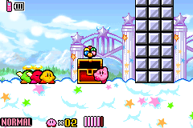

# Generic chest reward art

Every treasure chest uses the supplied six-gem reward art on opening. The
closed chest, rising popup motion, sounds, duration, original reward logic, and
check IDs are unchanged. Physical levers are not treasure chests even though
they reuse the native Chest task. The assets, vanilla boss sequences, and other
reward surfaces are not changed by this hook.

| Original | Same frame with this patch |
| --- | --- |
|  |  |

Both panels are native mGBA frames from a cold Tutorial World Map Chest replay
(room 805, frame 18405), with identical input and no gameplay-RAM edits. Exactly
206 rendered pixels differ, all inside the 16×16 sprite at (104, 57).
The compared runs recorded the same chest flags and reached Central Circle.

## ROM contract

The sole call from the chest-open handler to ChestItemPopup at ROM offset
`0xB3FE` passes a visual-only argument. The new wrapper selects the same
native single-frame visual slot every time, including for an empty chest.
The parent chest's original reward still governs the real item, AP suppression,
reward timing, room counter and saving. The wrapper replaces only the matching
128-byte tile upload at the native queue boundary. It does not change the
shared animation, tile or palette tables and does not allocate a custom slot.

`chest_reward_art.png` retains the exact 16×16 RGBA pixel grid of the supplied
100× enlarged art. The encoded preview (`chest_reward_art_gba.png`) uses the
native pickup palette in OBJ bank F. Stock GBA colors approximate the reference
colors without overwriting palette entries used elsewhere. Regenerate the
preview and tile header with `kirby_ap_payload/generate_chest_reward_art.py`
and Pillow, then rebuild the USA ROM patch.
