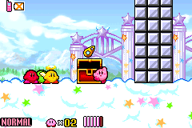
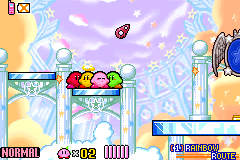
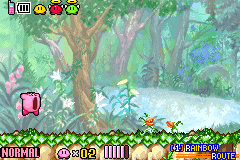
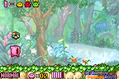
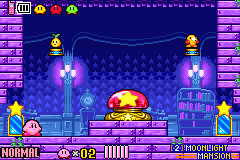
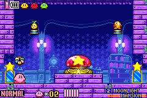

# Shared location reward art

**Custom sprite artwork by Aarcayne Art.**

The supplied six-gem art is the fallback reward sprite for treasure chests,
physical lever pulls, Archipelago Big Switches, Goal Games (even with no
native prize), first area visits, area-boss Mirror Shard drops, RoomSanity,
and core landmarks. The location can instead show a trap or a supported
local item, as described below. Gameplay, checks, audio and native saving are
unaffected. Restoring a saved lever or receiving Lever Wall shows no new art.
A boss defeat with the shard already owned still shows its native Maxim Tomato.

The following captures document the earlier, generic-only location pass.

| Original | Same frame with this patch |
| --- | --- |
|  |  |

Both panels are native mGBA frames from a cold Tutorial World Map Chest replay
(room 805, frame 18405), with identical input and no gameplay-RAM edits. Exactly
206 rendered pixels differ, all inside the 16×16 sprite at (104, 57).
The compared runs recorded the same chest flags and reached Central Circle.

## Custom key rewards

**Custom Area Key artwork by Aarcayne Art.** Harrison supplied the nine
[original PNGs](assets/area-keys-1139/) and confirmed their area assignments in
[#1139](https://github.com/hasherwi/Archipelago-kirbyam/issues/1139). The originals
are unchanged. Each 1600×1600 file is a uniform 100× nearest-neighbor enlargement
of a 16×16 sprite. The [converter](../kirby_ap_payload/generate_area_key_art.py)
samples those exact cells (no redrawing or dithering), drops the translucent
shadow at alpha <128, and maps opaque pixels to the nearest nontransparent
entry in the existing GBA OBJ bank F. Color distances weight red, green and
blue 3:4:2 and ties choose the earlier palette index. This preserves the
silhouette, palette-bank isolation and simultaneous reward rendering.
The result is four 8×8 4bpp tiles per key. Palette limits shift some shades,
especially purple, toward the closest available color.

The [Copy Ability Room key PNG](assets/area-keys-1139/10-copy-ability-room.png)
is by **Aarcayne Art** (the `Area_Key_Rainbow2.png` sprite in the artist’s
KaTAM Sprites bundle); the project owner supplied and selected it. It is converted
using the same grid and palette, keeping the key’s warm highlights in the gold
range rather than collapsing them into pink. It represents the existing Copy Ability Room
Access item only and does not change the room, door, or unlock behavior.

The ROM table at `0x0900C000` is independent of the native collectible
table. A missing table/entry falls back to the AP gem. Your own location awards
and live acknowledged rewards from another world use the matching key icon;
outgoing non-traps, unknown items and starting history retain their existing
behavior. Rainbow Route starts precollected only when Area Keys are enabled;
nothing randomizes it into the pool. Its mirror rule is separate from the
starting mirror to Room 1-01. Boss, Goal Game and Tutorial escape routes
remain unchanged.

| Your own Mustard Mountain Key | Incoming Cabbage Cavern Key |
| --- | --- |
|  |  |

Both frames were captured unedited in mGBA from the same generated two-player
seed, using the production KirbyAM client and a private AP server. One player
opened their own tutorial chest and later received the other player’s Cabbage
Key. The sender's own chest showed the AP gem while the receiver displayed
the key only after its acknowledgement. The native renderer uploaded the
matching tile data for both. The precollected Rainbow key was present before
connecting and did not produce a starting-history popup.

The Copy Ability Room key was separately captured in mGBA for an [own
tutorial chest award](assets/area-keys-1139/evidence/local-copy-room-key.png)
and an [acknowledged incoming award](assets/area-keys-1139/evidence/incoming-copy-room-key.png)
from a second world. The test seed's sender saw the AP gem; both receiver
frames are unedited, with the packed tiles checked against native VRAM.

## Physical lever replay

| Chest-only control | Same frame with lever art |
| --- | --- |
|  |  |

These are native mGBA frames from Moonlight Mansion Room 2-11 (internal room
743), 12 frames after the physical lever pull at frame 40902. Both input-only
runs started from blank SRAM and matched all 115 replay checkpoints through
frame 41104, with no gameplay RAM edits or save-state loads. All changed pixels
in the comparison are inside the 16×16 sprite at (115, 41). Only the candidate
queued the gem on the pull. Both runs recorded the same physical activation
flags, and neither granted Lever Wall ownership.

## Physical Big Switch replay

| Chest/lever-only control | Same frame with Big Switch art |
| --- | --- |
|  |  |

These are native mGBA frames in Moonlight Mansion Room 2-6 (internal room 790),
four frames after the physical press. Both runs started from the same tracked
pre-press state and used the same controller input, with no runtime memory edits.
All 196 changed pixels in this frame are inside the 16×16 gem at (120, 80).
The two runs matched all recorded gameplay fields over 712 frames, including
the native pause and map sequence, the AP check and save at frame 75, player
positions, and the later exit and re-entry. The corresponding hub connection
stayed closed without receiving its item. The new build queued the gem exactly
once, on the press at frame 41, and did not requeue it after re-entry.

## Goal Game replay

| Zero-prize control | Same frame with Goal Game art |
| --- | --- |
|  |  |

This is the first physical Goal Game source (room 557 to cabinet 980), 33
frames after the authenticated completion. Both zero- and one-prize input
routes used an isolated blank-save native startup-room fixture, with no runtime
memory edits. Candidate and control matched all 1,180 sampled gameplay states
per route. Both recorded the expected native-file-0 check at frame 2185 and
returned to Central Circle at frame 2639. Read-only native callback counting
confirmed unchanged prize counts (0 and 1) and landing counts (62 each). The
candidate queued the gem exactly once on the new check in each route.

## First area visit replay

| First visit control | Same frame with first-visit art |
| --- | --- |
|  |  |

Both native mGBA runs start from blank SRAM and the same controller replay,
without a loaded save state or runtime writes. The first Rainbow Route visit
is recorded upon entering Central Circle (room 801) at frame 21307. The effect
waits for the room to become visible and queues at frame 21439, with 32 visible
frames. All 200 changed pixels in the illustrated frame fall inside the gem.
Both runs match the native visit events and progress to Room 1-01; entering
that second room does not display another first-area gem. Transient VBlank
phase differences during the scripted transition settle before the gem draws.

## Area boss Mirror Shard replay

| Native collectible | Same native collectible with gem art |
| --- | --- |
|  |  |

Both runs use controller input for the native King Golem fight in room 710.
The before image uses the same rendering hook with only substitution disabled.
All 215 changed pixels fall within the original/replacement sprite rectangle.
The two versions matched 4,996 unowned-shard and 3,596 owned-shard state
samples. The unowned playthrough completes pickup and native return to Central
Circle. The already-owned [Maxim Tomato branch](boss_shard_already_owned_in_game.png)
is pixel-identical with and without substitution, and has no gem upload.

## RoomSanity and core landmark replays

| Native visit | Control | With gem |
| --- | --- | --- |
| Rainbow Route Room 1-01 |  |  |
| Moonlight Mansion Hub (core, RoomSanity off) |  |  |

Ordinary Room 1-01 (native room 101, visit 21) is newly visited after Rainbow
Route's first-area check. The On and Off lanes match all 662 sampled gameplay
states including their native room visit bits. On gives one gem at Room 1-01
and Off gives none. Earlier entry to Central Circle earns an area check and,
with RoomSanity On, a room check, but displays only one gem for that arrival.

The Moonlight Mansion core hub (native room 790, visit 80) still gives a gem
with RoomSanity Off. All 762 game samples match the control. The area has
already been visited in another room before the landmark triggers, and a
later re-entry does not show a second gem. Each illustrated pair differs by
exactly 200 pixels, all inside the 16×16 art. These are actual mGBA controller
replays; the core fixture uses a ROM startup position, not a live RAM edit.

## ROM contract

The sole call from the chest-open handler to ChestItemPopup at ROM offset
`0xB3FE` passes a visual-only argument. The new wrapper selects the same
native single-frame visual slot every time, including for an empty chest.
The parent chest's original reward still governs the real item, AP suppression,
reward timing, room counter and saving. The wrapper replaces only the matching
128-byte tile upload at the native queue boundary. It does not change the
shared animation, tile or palette tables and does not allocate a custom slot.

`chest_reward_art.png` retains the exact 16×16 RGBA pixel grid of the supplied
100× enlarged art. The encoded preview (`chest_reward_art_gba.png`) uses the
native pickup palette in OBJ bank F. Stock GBA colors approximate the reference
colors without overwriting palette entries used elsewhere. Regenerate the
preview and tile header with `kirby_ap_payload/generate_chest_reward_art.py`
and Pillow, then rebuild the USA ROM patch.

The Big Switch hook is its native world-map branch at ROM offset `0x1199F6`.
Only the 15 AP Big Switch identities qualify. Check for the fresh press edge,
the native press latch, and the persisted AP check without writing those fields.
Keep the original dispatch intact. A short-lived, parentless effect uses the
same four tiles and palette as the two chest-task families, without invoking
the chest reward callback. It stops drawing when that check persists, the
player leaves the room, or the effect expires.

Goal Games reuse the parentless art without touching native prize collection.
The shipping landing handler records the physical check only after the native
completion step, and now reports whether the authenticated save record changed.
Only that fresh-check result shows a reward sprite. Its position stays inside the
current cabinet view even when Kirby has moved above the camera for the native
return sequence. A completed cabinet remains playable without another reward sprite.

The native visit writer stays authoritative. The hook reads the same
catalog-derived area identity and native high visit bit used by the client,
and does not write an extra check or grant. Any newly set area visit queues
only a transient visual tied to the active native save and destination. The
effect waits until the local room, native player state, and native palette
state allow it to draw. File changes, room changes, and timeouts clear pending
visuals. Areas already established by any mapped room do not replay.

Only the native eight dynamic area-boss shard drops are eligible. Separate
constructor, normal-update, paused-update, and draw callsites preserve the
native object's original animation state, collision box, pickup and cutscene.
The native sprite's tile queue keeps the same destinations and order; only
matching tile uploads and rendered art are substituted. Retail consumables
use only their four native tiles. The Dimension Mirror, separate cutscene
art, and menus/credits are unchanged. The authenticated visual-only record
can remember the first special art across the next normal native save.

RoomSanity uses the same native visits and waits for the same visible-room
gate. A dedicated versioned seed config selects all 263 catalogued RoomSanity
locations or only the eight core landmarks; it works offline. Coalescing
first area and room art never coalesces or edits their AP location checks.
Historical patch archives retain their original procedure and behavior.

## Resource pressure

The popup is cosmetic, so it gives way to native gameplay allocations. Before
selecting the four-tile chest presentation, check for a valid contiguous run
in the native sprite heap. Without one, the native no-art variant still starts
the original reward timer; the item or wall logic still reads the same
parent chest. Shared standalone effects similarly skip unavailable artwork.
A returned scheduler task without valid heap data is detached without either
initializing the nonexistent data or running its effect destructor.

In an isolated mGBA pressure test, the older Big Switch popup attempted to
clear the EWRAM heap head when both native task heaps were full. The guarded
version dropped that task and the physical switch check still recorded.
Forcing zero sprite-heap capacity at the chest constructor previously queued
128 bytes to address 0; the guarded version queued nothing and returned with
the native no-art variant. This test does not imply ordinary gameplay exhausts
either heap. With normal resources, the 712-frame Big Switch replay and
screenshot were unchanged.

## Trap and consumable placement art

The seed writes a versioned sparse lookup of **this slot's physical check**
identities and selected sprite variants. A check which sends a trap to any
other player shows the same red trap art as a check that finds one for
yourself. A known Kirby consumable uses its native picture only if that check
gives the item to this Kirby slot; a non-trap consumable sent to another
player keeps the six-gem sprite. Other unsupported placements keep the gem.
No recipient, item name, or receipt data are embedded in the lookup. An empty
or unrecognized table renders generic art.

The sixteen-pixel source is preserved in `trap_reward_art.png`. The
four-tile OBJ version in `trap_reward_art_gba.png` intentionally stretches
the near-black red values onto the same stock palette used by the gem, so
both may render together without changing any other sprite colors.

A simultaneous first-area and RoomSanity or core-landmark check shares an
effect only when the art matches. Distinct icons appear side by side, with
the trap first, then consumables, then the gem if graphics memory fits only
one. An area-boss reward uses the same selection to replace the native
Mirror Shard art. Repeat drops stay generic, and the already-owned-shard
Tomato is unchanged. The cosmetic boss bit uses the seed-bound native save's
existing reserved bits and never triggers a save or counts as a defeat.
Resetting before the next normal save can replay the unsaved visual; the
server's check and item deduplication is unmodified.

The native 1-Up, cherry food, Energy Drink, meat, Maxim Tomato, invincibility
candy, and phone battery use stock animation `0x2D1` variants 0, 4, 2, 5,
3, 1, and 6, respectively. The build validates their shared palette and
16×16 tile scripts. The payload references the tiles already in the clean
ROM instead of copying them into the patch or installing another palette.
The native Mirror Shard's larger initial upload is capped to four tiles
only when displaying one of these retail icons.

## Incoming item presentation

A new live cross-world receipt can also display an icon near Kirby, separate
from the sender's location sprite. The client waits for a first confirmed ROM
delivery acknowledgment, with live append provenance from the current
Archipelago connection, before enqueuing the effect. The cosmetic queue is
bounded, independent of sound and not consulted by item delivery. No visual
is replayed for reconnect inventory, queued catch-up, starting inventory,
duplicate acknowledgments, or checks found in Kirby's own world.

A trap uses the red trap icon; each known Kirby consumable uses its native
icon, and other arrivals use the generic gem. The ROM takes one fresh
presentation request at a time only
during an authenticated, visible gameplay scene. It does not spawn a pickup
or alter the item, timing, native events or persistence. A visual may be
dropped when the queue or native memory is full. As with the other optional
effects, a pause, room change, or native-file load cancels active artwork.

## Collectible reward art

Native icons are also selected for each of the nine area Maps and nine
Vitality Counters, the Sound Player, all fourteen spray paints, all ten
music sheets, and all eight Mirror Shard items. These follow the same
recipient rule as consumables: show collectible art for a local check
that awards the item to this Kirby, or for a fresh remotely found receipt
that this Kirby confirms. Outgoing non-trap items still show the gem.
Trap classification always wins.

Vitality and Sound Player use their four existing bank-F tiles directly.
Map, paint, and sheet variants retain the native shape and their individual
retail color choices, approximated in bank F without replacing live
palettes. For arbitrary check popups an original Mirror Shard frame is
scaled to 16×16; the actual boss's Mirror Shard keeps its full original
animation when that boss awards a shard. The existing native pickup,
collision, persistence, and reward logic are not used by the cosmetic
display and are not changed.

The build validates the stock tile/script/palette layout before writing the
versioned collectible art block. Seed art data (ARV3) stores sorted physical
keys and separate variant bytes; the ROM and client negotiate APVIS03 for
receipt display. A coincident first area and room check still shows both
different icons, including high-ID collectibles.

### Rotating Mirror Shard award

A visible Mirror Shard award uses the nine retail rotation frames and their
original 40-tick timing. The nearby part of the native 23-tick sparkle burst
is baked into the same 32×32 icon. It is a short burst, not a permanent
glow. The original particles can extend farther than the popup; particles
outside its rounded boundary are clipped. Matching native boss drops retain their
complete original effect instead of receiving another one.

The effect adds no pickup and uses existing palette bank F without writing
new palette or blend state. It allocates one temporary, bounded graphics
slot and only enqueues changed frames. Without a safe 32×32 slot, small
popups can use the static shard, or omit the cosmetic art under pressure.
For a chest, the original native timer still controls the reward. On scene
exit the visual abandons only its own pending graphics transfers.

### Phone and access item awards

A local Phone-a-Friend, Hub Connection, or Lever Wall check reward, and
a first confirmed live remote receipt of one of these items, also use
their own art. The handset uses Pink Kirby's stock HUD tiles and palette
as a fixed source even when the player chose another color. Hub Connection
uses the raised red Big Switch; Lever Wall uses the upright gold-and-red
native lever. The two larger objects are scaled to the existing 16×16
popup and all three use existing bank F. A reward visual never operates
the phone, a switch, or a lever; those mechanics are unchanged. Outgoing
non-trap items still use the generic gem.

### Copy-ability unlock awards

Only unlocks with a verified native ability statue use statue art. The
nineteen stock frames are Beam, Burning, Laser, Fire, Stone, Fighter, Bomb,
Tornado, Wheel, Ice, Spark, Missile, Smash, Throw, Hammer, Sword, Cutter,
Cupid, and Parasol. The payload uses their 16×16 native shapes with the
existing popup palette; it will not spawn a statue or transform Kirby.

The remaining ability unlocks (Sleep, Cook, UFO, Magic, Mini, and Crash)
and Master's separate stand do not use statue art. These keep the generic gem,
as do outgoing non-trap items and
unsupported placements. A live incoming statue award is still purely
visual and happens only after its separate ROM delivery acknowledgment.
