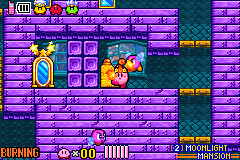
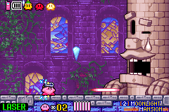
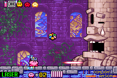

# Shared location reward art

Every treasure chest uses the supplied six-gem reward art on opening. The
closed chest, rising popup motion, sounds, duration, original reward logic, and
check IDs are unchanged. A physical lever pull shows the same art because it
uses the same native popup path. Receiving Lever Wall, restoring a lever, or
re-entering its room does not show the art. The same gem also appears on the
first physical press of an Archipelago Big Switch and the first completion
of each Goal Game check (even with no native prize), on first area visits,
and replaces the collectible Mirror Shard art dropped by an area boss. A
defeat with the shard already owned still shows its native Maxim Tomato.
Fresh RoomSanity checks and always-on core landmarks also use the gem.

| Original | Same frame with this patch |
| --- | --- |
|  |  |

Both panels are native mGBA frames from a cold Tutorial World Map Chest replay
(room 805, frame 18405), with identical input and no gameplay-RAM edits. Exactly
206 rendered pixels differ, all inside the 16×16 sprite at (104, 57).
The compared runs recorded the same chest flags and reached Central Circle.

## Physical lever replay

| Chest-only control | Same frame with lever art |
| --- | --- |
|  |  |

These are native mGBA frames from Moonlight Mansion Room 2-11 (internal room
743), 12 frames after the physical lever pull at frame 40902. Both input-only
runs started from blank SRAM and matched all 115 replay checkpoints through
frame 41104, with no gameplay RAM edits or save-state loads. All changed pixels
in the comparison are inside the 16×16 sprite at (115, 41). Only the candidate
queued the gem on the pull. Both runs recorded the same physical activation
flags, and neither granted Lever Wall ownership.

## Physical Big Switch replay

| Chest/lever-only control | Same frame with Big Switch art |
| --- | --- |
|  |  |

These are native mGBA frames in Moonlight Mansion Room 2-6 (internal room 790),
four frames after the physical press. Both runs started from the same tracked
pre-press state and used the same controller input, with no runtime memory edits.
All 196 changed pixels in this frame are inside the 16×16 gem at (120, 80).
The two runs matched all recorded gameplay fields over 712 frames, including
the native pause and map sequence, the AP check and save at frame 75, player
positions, and the later exit and re-entry. The corresponding hub connection
stayed closed without receiving its item. The new build queued the gem exactly
once, on the press at frame 41, and did not requeue it after re-entry.

## Goal Game replay

| Zero-prize control | Same frame with Goal Game art |
| --- | --- |
|  |  |

This is the first physical Goal Game source (room 557 to cabinet 980), 33
frames after the authenticated completion. Both zero- and one-prize input
routes used an isolated blank-save native startup-room fixture, with no runtime
memory edits. Candidate and control matched all 1,180 sampled gameplay states
per route. Both recorded the expected native-file-0 check at frame 2185 and
returned to Central Circle at frame 2639. Read-only native callback counting
confirmed unchanged prize counts (0 and 1) and landing counts (62 each). The
candidate queued the gem exactly once on the new check in each route.

## First area visit replay

| First visit control | Same frame with first-visit art |
| --- | --- |
|  |  |

Both native mGBA runs start from blank SRAM and the same controller replay,
without a loaded save state or runtime writes. The first Rainbow Route visit
is recorded upon entering Central Circle (room 801) at frame 21307. The effect
waits for the room to become visible and queues at frame 21439, with 32 visible
frames. All 200 changed pixels in the illustrated frame fall inside the gem.
Both runs match the native visit events and progress to Room 1-01; entering
that second room does not display another first-area gem. Transient VBlank
phase differences during the scripted transition settle before the gem draws.

## Area boss Mirror Shard replay

| Native collectible | Same native collectible with gem art |
| --- | --- |
|  |  |

Both runs use controller input for the native King Golem fight in room 710.
The before image uses the same rendering hook with only substitution disabled.
All 215 changed pixels fall within the original/replacement sprite rectangle.
The two versions matched 4,996 unowned-shard and 3,596 owned-shard state
samples. The unowned playthrough completes pickup and native return to Central
Circle. The already-owned [Maxim Tomato branch](boss_shard_already_owned_in_game.png)
is pixel-identical with and without substitution, and has no gem upload.

## RoomSanity and core landmark replays

| Native visit | Control | With gem |
| --- | --- | --- |
| Rainbow Route Room 1-01 |  |  |
| Moonlight Mansion Hub (core, RoomSanity off) |  |  |

Ordinary Room 1-01 (native room 101, visit 21) is newly visited after Rainbow
Route's first-area check. The On and Off lanes match all 662 sampled gameplay
states including their native room visit bits. On gives one gem at Room 1-01
and Off gives none. Earlier entry to Central Circle earns an area check and,
with RoomSanity On, a room check, but displays only one gem for that arrival.

The Moonlight Mansion core hub (native room 790, visit 80) still gives a gem
with RoomSanity Off. All 762 game samples match the control. The area has
already been visited in another room before the landmark triggers, and a
later re-entry does not show a second gem. Each illustrated pair differs by
exactly 200 pixels, all inside the 16×16 art. These are actual mGBA controller
replays; the core fixture uses a ROM startup position, not a live RAM edit.

## ROM contract

The sole call from the chest-open handler to ChestItemPopup at ROM offset
`0xB3FE` passes a visual-only argument. The new wrapper selects the same
native single-frame visual slot every time, including for an empty chest.
The parent chest's original reward still governs the real item, AP suppression,
reward timing, room counter and saving. The wrapper replaces only the matching
128-byte tile upload at the native queue boundary. It does not change the
shared animation, tile or palette tables and does not allocate a custom slot.

`chest_reward_art.png` retains the exact 16×16 RGBA pixel grid of the supplied
100× enlarged art. The encoded preview (`chest_reward_art_gba.png`) uses the
native pickup palette in OBJ bank F. Stock GBA colors approximate the reference
colors without overwriting palette entries used elsewhere. Regenerate the
preview and tile header with `kirby_ap_payload/generate_chest_reward_art.py`
and Pillow, then rebuild the USA ROM patch.

The Big Switch hook is its native world-map branch at ROM offset `0x1199F6`.
Only the 15 AP Big Switch identities qualify. Check for the fresh press edge,
the native press latch, and the persisted AP check without writing those fields.
Keep the original dispatch intact. A short-lived, parentless effect uses the
same four tiles and palette as the two chest-task families, without invoking
the chest reward callback. It stops drawing when that check persists, the
player leaves the room, or the effect expires.

Goal Games reuse the parentless art without touching native prize collection.
The shipping landing handler records the physical check only after the native
completion step, and now reports whether the authenticated save record changed.
Only that fresh-check result shows the gem. Its position stays inside the
current cabinet view even when Kirby has moved above the camera for the native
return sequence. A completed cabinet remains playable without another AP gem.

The native visit writer stays authoritative. The hook reads the same
catalog-derived area identity and native high visit bit used by the client,
and does not write an extra check or grant. Any newly set area visit queues
only a transient visual tied to the active native save and destination. The
effect waits until the local room, native player state, and native palette
state allow it to draw. File changes, room changes, and timeouts clear pending
visuals. Areas already established by any mapped room do not replay.

Only the native eight dynamic area-boss shard drops are eligible. Separate
constructor, normal-update, paused-update, and draw callsites preserve the
native object's original animation state, collision box, pickup and cutscene.
The native sprite's tile queue keeps the same destinations, order and byte
lengths; only its matching tile sources and rendered image are substituted.
The Dimension Mirror, separate cutscene art, and menus/credits are not changed.
No cosmetic state is created or used. A record from the earlier draft remains
readable and its obsolete cosmetic bits are preserved by check recovery.

RoomSanity uses the same native visits and waits for the same visible-room
gate. A dedicated versioned seed config selects all 263 catalogued RoomSanity
locations or only the eight core landmarks; it works offline. Coalescing
first area and room art never coalesces or edits their AP location checks.
Historical patch archives retain their original procedure and behavior.

## Resource pressure

The popup is cosmetic, so it gives way to native gameplay allocations. Before
selecting the four-tile chest presentation, check for a valid contiguous run
in the native sprite heap. Without one, the native no-art variant still starts
the original reward timer; the item or wall logic still reads the same
parent chest. Shared standalone effects similarly skip unavailable artwork.
A returned scheduler task without valid heap data is detached without either
initializing the nonexistent data or running its effect destructor.

In an isolated mGBA pressure test, the older Big Switch popup attempted to
clear the EWRAM heap head when both native task heaps were full. The guarded
version dropped that task and the physical switch check still recorded.
Forcing zero sprite-heap capacity at the chest constructor previously queued
128 bytes to address 0; the guarded version queued nothing and returned with
the native no-art variant. This test does not imply ordinary gameplay exhausts
either heap. With normal resources, the 712-frame Big Switch replay and
screenshot were unchanged.
