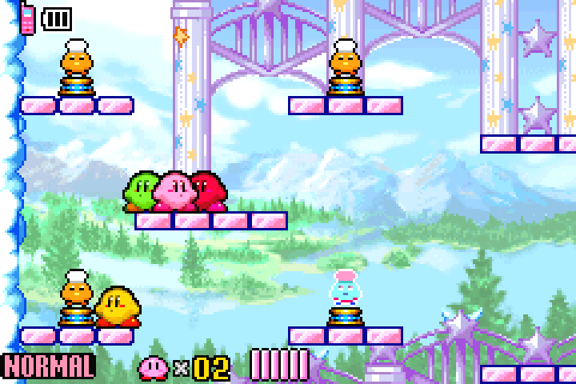
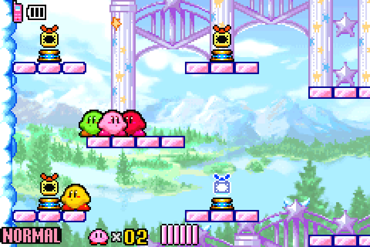
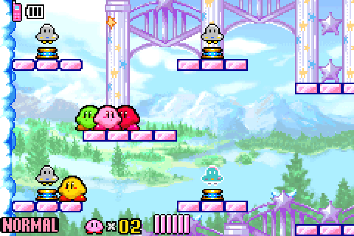
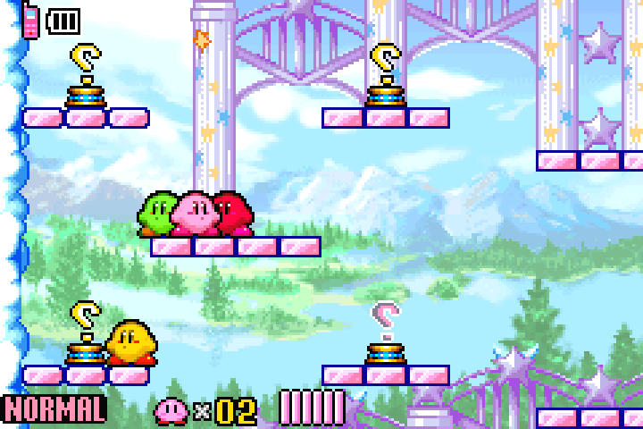
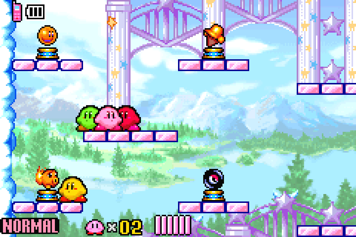
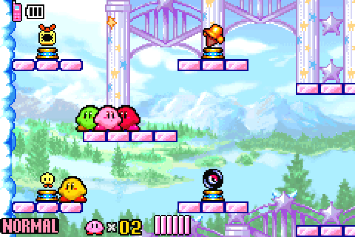

# Ability-statue visuals (#824)

Shuffled statues display the assigned ability. Completely Random statues display
an original question-mark icon; their existing per-touch RNG and gating remain
unchanged. Off mode and the disabled statue toggle leave all visual bytes alone.
The Master Sword stand is outside the 19 regular statue records.

## ROM-backed mapping

`data/abilities.json` now declares `native_regular_statue` for every ability.
A non-null object has these fields:

- `grant_rom_offset`: hexadecimal **file offset** of the native one-byte grant.
- `animation_info_rom_offset`: hexadecimal **file offset** of its four-byte
  `AnimInfo` record (`u16 animation ID`, `u8 variant`, `u8 padding`).
- `animation_id` and `animation_variant`: numeric native animation selectors,
  not addresses or ability IDs.

`null` means no mapping in the verified **regular statue table**. It does not
claim that the ROM lacks every possible graphic for that ability. Master is null
because its separate stand must retain native behavior. The parser rejects GBA
pointers used as offsets, duplicate slots/variants, incomplete records, and
records outside the verified USA layout. Existing ability consumers ignore the
additional field.

The mapping was checked directly against the lawful local USA ROM with SHA-256
`cfb194cd0cb373787094a962852e3e564fb2ecdb0609fe065afdd8de3f4e11f1`.
[The inventory](assets/statues/rom-inventory.json) records the 19 verified entries
and six ordinary-enemy art candidates. The decompilation's
[`ability_objects.c`](https://github.com/jiangzhengwenjz/katam/blob/7d969fbce14fdc838d2c1ea01389717fb96c3189/src/ability_objects.c)
provides the corresponding native grant and animation tables.

### UFO and Bomber investigation

The USA animation `0x384` table contains 31 variants: boss portraits 0–10,
regular ability icons 11–29, and the pedestal at 30. All 31 were decoded and
visually inspected. The regular statue room object types are `0x92`–`0x95`;
`0x96` creates random regular statues. Native rooms 950 and 970 contain all
19 regular entries. Scanning the room object lists did not identify a separate
UFO or Bomber statue record in these tables.

Ordinary **UFO** (`0x1B`, animation `0x326`, first frame 24×32) and **Bomber**
(`0x28`, animation `0x32B`, first frame 24×24) art is confirmed. These have
separate palettes and multi-OBJ layouts, rather than the 16×16 regular-statue
format. Their native room records are enemy records; that alone does not prove
or disprove the existence of other unused or background statue art. Separate
UFO/Bomber statue assets remain **unverified**, pending an identifiable location
or additional ROM evidence. The draft's new icons should be replaced if existing
compatible statue art is subsequently verified.

The other inspected enemy frames were Cookin (`0x30B`, 64×24), Boxy (`0x338`,
56×48), Minny (`0x2FF`, 16×16, different palette/origin), and Noddy (`0x322`,
24×24). They are useful visual references, not interchangeable animation records.
No graphics from another Kirby game were copied.

## Implementation

The `apply_statue_art` patch procedure runs **after** generation's grant tokens.
It reads the resulting 19 grants, validates the native animation records, and
changes only their display selectors plus animation `0x384`'s table pointer.
It preserves all 31 original variant pointers and appends seven custom variants.
Their scripts reuse native frame 11 (one 16×16 OBJ) and palette 429. All pixel
rows are editable hexadecimal palette indexes in `data/statue_art.json`; no
image library is needed to apply a patch. The art data and encoder are separate
from statue gameplay and can support a later pickup-icon feature.

The extension is aligned and appended at EOF. It never occupies presumed free
retail padding or overwrites another appended extension. No native hook,
mailbox/save field, RNG, collision, touch callback, or grant byte changes.
`base_patch.bsdiff4` is unchanged and does not require regeneration for this PR.
Changing the shared base patch for another feature still requires the normal
source-based rebuild; do not choose conflicting binaries mechanically.

## Validation and review boundary

Automated tests cover all 19 slots × all 25 target abilities in both active
modes, all six off/toggle/mode combinations, deterministic generation, complete
native variant preservation, exact unrelated-byte preservation (including
Master Sword), malformed metadata/layouts, repatching rejection, and 4bpp
pixel encoding. Existing statue runtime/gating tests remain applicable because
this change does not modify their code or configuration.

The screenshots below came from actual mGBA 0.10.5 emulation of the current
base patch plus this visual procedure. An isolated fixture changed only the
new-game origin to native room 950 and set all 19 grant bytes to the named
ability. Area keys and gating were disabled for that fixture. Movement and
statue contact used controller inputs; no running game's memory was edited.
The final observed acquired ability IDs were Cook 12, Crash 24, Magic 21,
Mini 23, Sleep 11, and UFO 14. The question-mark fixture validates rendering,
not live per-touch rerolls; its fallback grant was Cook. A separate mixed
fixture checks coexistence with native icons. Existing saves and the shared
interactive emulator were not used or modified; ROMs and states remain private.

These are controlled visual/collection fixtures, not acceptance of a full
randomized multiworld session. Linked-GBA co-op, save/reload, reconnect, and
human art approval are not claimed. The question glyph currently follows the
native statue facing and therefore mirrors on opposite-facing stands; that
presentation needs review before this draft is finalized.

| Cook | Crash | Magic |
| --- | --- | --- |
|  |  |  |

| Mini | Sleep | UFO |
| --- | --- | --- |
|  |  |  |

| Completely Random display | Native/off | Mixed shuffled display |
| --- | --- | --- |
|  |  |  |
