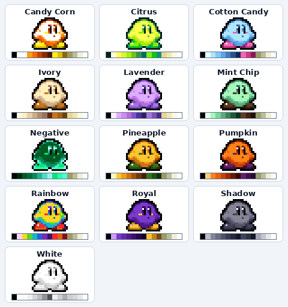

# Kirby color palettes

See the colors you can use now and the palettes under consideration for a future release. Each entry shows the same normal Kirby sprite alongside its swatches. These are previews, not gameplay screenshots; abilities and effects can change how some colors appear in-game.

## Available now

Pick any of these **27 colors** with `starting_kirby_color` in your Kirby YAML. For example:

```yaml
Kirby & The Amazing Mirror:
  starting_kirby_color: cotton_candy
```

**Pink** is the in-game default. Use `random` to pick a color when the seed is generated, or `random_color_per_room` to change color between rooms with the connected BizHawk client. These are modes, not separate palettes.

### Original colors


### Additional starting colors



<details>
<summary>All 27 color names and YAML values</summary>

**Original colors**

| Color | YAML value |
| --- | --- |
| Carbon | `carbon` |
| Chalk | `chalk` |
| Cherry | `cherry` |
| Chocolate | `chocolate` |
| Emerald | `emerald` |
| Grape | `grape` |
| Green | `green` |
| Ocean | `ocean` |
| Orange | `orange` |
| Pink | `pink` |
| Red | `red` |
| Sapphire | `sapphire` |
| Snow | `snow` |
| Yellow | `yellow` |

**Additional starting colors**

| Color | YAML value |
| --- | --- |
| Candy Corn | `candy_corn` |
| Citrus | `citrus` |
| Cotton Candy | `cotton_candy` |
| Ivory | `ivory` |
| Lavender | `lavender` |
| Mint Chip | `mint_chip` |
| Negative | `negative` |
| Pineapple | `pineapple` |
| Pumpkin | `pumpkin` |
| Rainbow | `rainbow` |
| Royal | `royal` |
| Shadow | `shadow` |
| White | `white` |

</details>

## Proposed colors

These **41 reference palettes** are not in the game and cannot be selected in YAML. The sprite mockups show how the reference swatches look on normal Kirby; they have not been implemented or checked in gameplay. Names and colors may change.


<details>
<summary>All 41 proposed color names</summary>

- Advance Ice
- Advance Meta Knight
- Advance Stone
- Beautiful Sunset
- Bright
- Calie
- Carrot Cake
- Daisy
- Dedede
- Edgey
- Galacta Knight
- Halloween
- KDL3 Pink
- Lalala
- Lemon
- Link
- Lololo
- Marie
- Marina
- Marx
- Meconopsis / Blue Poppy
- Mogeko
- Morpho Knight
- Pearl
- Purple
- Ramia’s Scale & Star Stone
- Rose
- Samus
- Snow Cone
- Spicy
- Strawberry Peach
- Superstar Ice
- Superstar Meta Knight
- Toad
- Ultra Beam
- Ultra Fire
- Ultra Mirror
- Ultra Ninja
- Ultra Plasma
- Ultra Stone
- Waddle Dee

</details>

## Preview sources

The original sprite previews and the swatches used for the proposed sprites come from the reference images in [GitHub issue #1035](https://github.com/hasherwi/Archipelago-kirbyam/issues/1035). The main sheet is credited to Drschnaps; the issue credits the palettes from Daisy through Blue Poppy to SapphireGemNetwork. The additional available colors apply the exact normal-gameplay RGB555 values from the [current color registry](../data/colors.json) to that same sprite’s indexed pixels. The proposal mockups use only the reference colors for the visible slots of that pose; they do not specify colors for other forms or effects. Kirby sprite artwork © Nintendo / HAL Laboratory.
