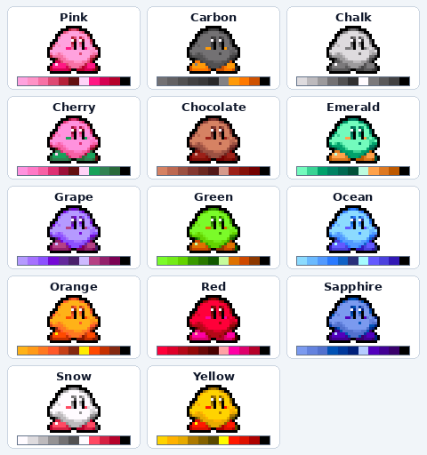
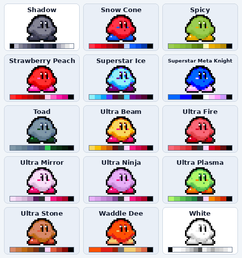

# Kirby color palettes

Browse **65 starting colors**: 14 from the original game and 51 custom KirbyAM colors. Each preview shows the same normal Kirby pose alongside its swatches, so you can compare colors directly. Copy abilities and effects can look different in-game. Select a color name to open its in-game screenshot.

## Choose your color

Set `starting_kirby_color` in your Kirby YAML. Use the exact value in the generated YAML for your build. For example:

```yaml
Kirby & The Amazing Mirror:
  starting_kirby_color: cotton_candy
```

**Pink** is the in-game default. Use `random` to pick a color when the seed is generated, or `random_color_per_room` to change color between rooms while connected through the KirbyAM client for BizHawk or mGBA. Without a connected client, the patched ROM applies only the initial color. These are modes, not separate palettes.

## Original colors



<details>
<summary>Original color screenshots and YAML values</summary>

| Color | YAML value |
| --- | --- |
| [Pink](color-palette-pink.png) | `pink` |
| [Carbon](color-palette-carbon.png) | `carbon` |
| [Chalk](color-palette-chalk.png) | `chalk` |
| [Cherry](color-palette-cherry.png) | `cherry` |
| [Chocolate](color-palette-chocolate.png) | `chocolate` |
| [Emerald](color-palette-emerald.png) | `emerald` |
| [Grape](color-palette-grape.png) | `grape` |
| [Green](color-palette-green.png) | `green` |
| [Ocean](color-palette-ocean.png) | `ocean` |
| [Orange](color-palette-orange.png) | `orange` |
| [Red](color-palette-red.png) | `red` |
| [Sapphire](color-palette-sapphire.png) | `sapphire` |
| [Snow](color-palette-snow.png) | `snow` |
| [Yellow](color-palette-yellow.png) | `yellow` |

</details>

## Custom Palettes




<details>
<summary>All 51 custom color screenshots</summary>

- [Advance Ice](color-palette-advance_ice.png)
- [Advance Stone](color-palette-advance_stone.png)
- [Beautiful Sunset](color-palette-beautiful_sunset.png)
- [Bright](color-palette-bright.png)
- [Calie](color-palette-calie.png)
- [Candy Corn](color-palette-candy_corn.png)
- [Carrot Cake](color-palette-carrot_cake.png)
- [Citrus](color-palette-citrus.png)
- [Cotton Candy](color-palette-cotton_candy.png)
- [Daisy](color-palette-daisy.png)
- [Dedede](color-palette-dedede.png)
- [Edgey](color-palette-edgey.png)
- [Galacta Knight](color-palette-galacta_knight.png)
- [Ivory](color-palette-ivory.png)
- [KDL3 Pink](color-palette-kdl3_pink.png)
- [Lalala](color-palette-lalala.png)
- [Lavender](color-palette-lavender.png)
- [Lemon](color-palette-lemon.png)
- [Link](color-palette-link.png)
- [Lololo](color-palette-lololo.png)
- [Marie](color-palette-marie.png)
- [Marina](color-palette-marina.png)
- [Marx](color-palette-marx.png)
- [Meconopsis / Blue Poppy](color-palette-meconopsis_blue_poppy.png)
- [Mint Chip](color-palette-mint_chip.png)
- [Mogeko](color-palette-mogeko.png)
- [Morpho Knight](color-palette-morpho_knight.png)
- [Negative](color-palette-negative.png)
- [Pearl](color-palette-pearl.png)
- [Pineapple](color-palette-pineapple.png)
- [Pumpkin](color-palette-pumpkin.png)
- [Purple](color-palette-purple.png)
- [Rainbow](color-palette-rainbow.png)
- [Ramia’s Scale & Star Stone](color-palette-ramias_scale_and_star_stone.png)
- [Rose](color-palette-rose.png)
- [Royal](color-palette-royal.png)
- [Shadow](color-palette-shadow.png)
- [Snow Cone](color-palette-snow_cone.png)
- [Spicy](color-palette-spicy.png)
- [Strawberry Peach](color-palette-strawberry_peach.png)
- [Superstar Ice](color-palette-superstar_ice.png)
- [Superstar Meta Knight](color-palette-superstar_meta_knight.png)
- [Toad](color-palette-toad.png)
- [Ultra Beam](color-palette-ultra_beam.png)
- [Ultra Fire](color-palette-ultra_fire.png)
- [Ultra Mirror](color-palette-ultra_mirror.png)
- [Ultra Ninja](color-palette-ultra_ninja.png)
- [Ultra Plasma](color-palette-ultra_plasma.png)
- [Ultra Stone](color-palette-ultra_stone.png)
- [Waddle Dee](color-palette-waddle_dee.png)
- [White](color-palette-white.png)

</details>

## Preview sources

The original sprite previews and the swatches for the reference-sheet palettes come from the reference images in [GitHub issue #1035](https://github.com/hasherwi/Archipelago-kirbyam/issues/1035). The main sheet is credited to Drschnaps; the issue credits the palettes from Daisy through Blue Poppy to SapphireGemNetwork. For some custom colors, previews apply normal-gameplay RGB555 values from the [color registry](../data/colors.json) to that same sprite’s indexed pixels. Previews based on the reference sheets illustrate the normal pose only; they do not show other forms or effects. The linked screenshots show the finished palettes in actual gameplay. Kirby sprite artwork © Nintendo / HAL Laboratory.
