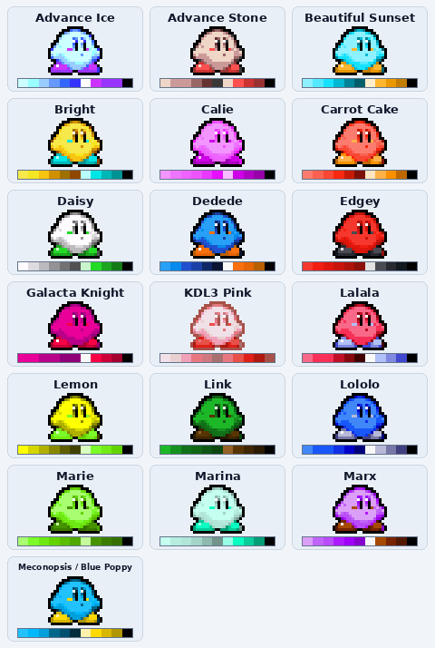
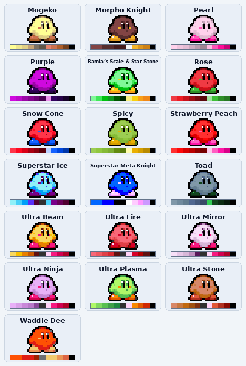

# Kirby color palettes

Browse **65 starting colors**: 14 from the original game and 51 additional KirbyAM colors. Each preview shows the same normal Kirby pose alongside its swatches, so you can compare colors directly. Copy abilities and effects can look different in-game.

## Choose your color

Set `starting_kirby_color` in your Kirby YAML. Use the exact value in the generated YAML for your build. For example:

```yaml
Kirby & The Amazing Mirror:
  starting_kirby_color: cotton_candy
```

**Pink** is the in-game default. Use `random` to pick a color when the seed is generated, or `random_color_per_room` to change color between rooms while connected through the KirbyAM client for BizHawk or mGBA. Without a connected client, the patched ROM applies only the initial color. These are modes, not separate palettes.

## Original colors


## Additional KirbyAM colors

### Curated palettes


<details>
<summary>Original and curated color names and YAML values</summary>

**Original colors**

| Color | YAML value |
| --- | --- |
| Pink | `pink` |
| Carbon | `carbon` |
| Chalk | `chalk` |
| Cherry | `cherry` |
| Chocolate | `chocolate` |
| Emerald | `emerald` |
| Grape | `grape` |
| Green | `green` |
| Ocean | `ocean` |
| Orange | `orange` |
| Red | `red` |
| Sapphire | `sapphire` |
| Snow | `snow` |
| Yellow | `yellow` |

**Curated palettes**

| Color | YAML value |
| --- | --- |
| Candy Corn | `candy_corn` |
| Citrus | `citrus` |
| Cotton Candy | `cotton_candy` |
| Ivory | `ivory` |
| Lavender | `lavender` |
| Mint Chip | `mint_chip` |
| Negative | `negative` |
| Pineapple | `pineapple` |
| Pumpkin | `pumpkin` |
| Rainbow | `rainbow` |
| Royal | `royal` |
| Shadow | `shadow` |
| White | `white` |

</details>

### Reference-sheet palettes





<details>
<summary>All 38 reference-sheet color names</summary>

- Advance Ice
- Advance Stone
- Beautiful Sunset
- Bright
- Calie
- Carrot Cake
- Daisy
- Dedede
- Edgey
- Galacta Knight
- KDL3 Pink
- Lalala
- Lemon
- Link
- Lololo
- Marie
- Marina
- Marx
- Meconopsis / Blue Poppy
- Mogeko
- Morpho Knight
- Pearl
- Purple
- Ramia’s Scale & Star Stone
- Rose
- Snow Cone
- Spicy
- Strawberry Peach
- Superstar Ice
- Superstar Meta Knight
- Toad
- Ultra Beam
- Ultra Fire
- Ultra Mirror
- Ultra Ninja
- Ultra Plasma
- Ultra Stone
- Waddle Dee

</details>

## Preview sources

The original sprite previews and the swatches for the reference-sheet palettes come from the reference images in [GitHub issue #1035](https://github.com/hasherwi/Archipelago-kirbyam/issues/1035). The main sheet is credited to Drschnaps; the issue credits the palettes from Daisy through Blue Poppy to SapphireGemNetwork. The curated previews apply normal-gameplay RGB555 values from the [color registry](../data/colors.json) to that same sprite’s indexed pixels. The reference-sheet previews illustrate the normal pose only; they do not show other forms or effects. Kirby sprite artwork © Nintendo / HAL Laboratory.
